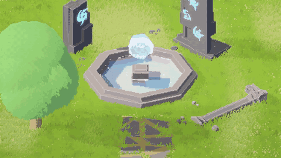
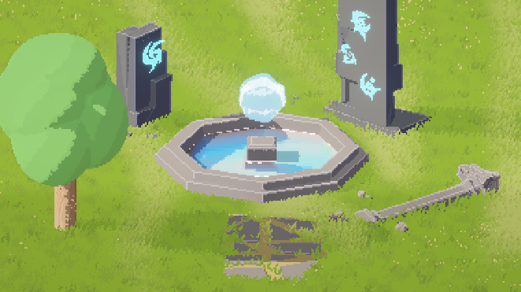
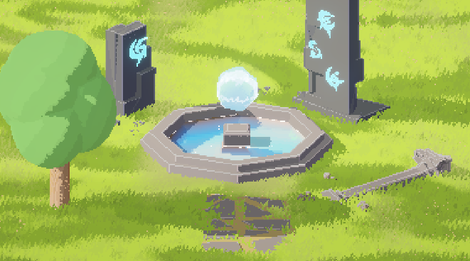

# 3D Pixel Art

几个基于 **Unity / URP** 的像素风 Shader，包含卡通光照与描边、草地、树叶、水面，以及能量球、符文和云影效果。附带一个展示场景和相关素材。

像素风格化渲染的实现方法参考了 **t3ssel8r** 的 3D 像素风渲染思路。

## 视频展示

[查看完整视频](https://github.com/nintreesssss/3D-Pixel-Art/blob/main/image/press_Movie_005.mp4)

## Shader 参数

下面列出几个主要参数，名称与材质面板对应。

### 卡通光照与描边 · `Cartoon.shadergraph`

| 参数 | 作用 |
| --- | --- |
| `MainColor` / `ShadowColor` | 主色与阴影颜色 |
| `Brightness` | 调整亮度 |
| `Shades` | 控制卡通光照的明暗分层 |
| `MinimumDarkness` | 调整暗部的最低亮度 |
| `UseShadow` | 控制阴影的参与程度 |
| `OutlineEnabled` / `OutlineColor` | 描边开关与颜色 |
| `DepthThreshold` | 深度边缘检测阈值，影响轮廓识别 |
| `NormalThreshold` | 法线边缘检测阈值，影响表面转折线的识别 |
| `DepthEdgeStrength` | 深度边缘的强度 |
| `DepthNormalStrength` | 法线边缘的强度 |
| `NormalBias` | 法线边缘检测的方向偏置 |
| `CloudOn` | 云影开关 |

### 草地与树叶 · `Grass.shadergraph` / `Leaf.shadergraph`

| 参数 | 作用 |
| --- | --- |
| `Texture2D` | 草或树叶的形状贴图 |
| `BaseColor` | 基础颜色 |
| `PatchColor1` / `PatchColor2` | 色块变化的两种颜色 |
| `NoiseScale` | 调整噪声色块的分布尺度 |
| `风向` | 风的方向 |
| `WindStrength` | 风吹动的强度 |
| `WindMovement` | 风场的移动参数 |
| `WindDensity` | 风场的疏密程度 |
| `WindColor` | 风扫过时的颜色 |
| `启用WindColor`（草）/ `UseWindColor`（树叶） | 控制风场颜色的混合 |
| `UseShadow` | 控制阴影的参与程度 |

### 水面 · `Water.shadergraph`

| 参数 | 作用 |
| --- | --- |
| `Color` / `Brightness` | 水面颜色与亮度 |
| `Shades` / `MinimumDarkness` | 明暗分层与暗部最低亮度 |
| `DistortionTexture` | 水面扰动使用的纹理 |
| `DistortionTiling` | 扰动纹理的平铺尺度 |
| `DistortionDirection` / `DistortionSpeed` | 扰动的方向与速度 |
| `DistortionStrength` | 扰动强度 |
| `FoamAmount` | 泡沫量 |
| `FoamScale` / `FoamSpeed` | 泡沫的尺度与运动速度 |
| `ReflectionStrength` | 反射强度 |
| `ReflectionDistortion` | 反射的扭曲程度 |
| `TintStrength` / `TintBrightness` | 染色强度与亮度 |

### 能量球 · `CartoonEnergySphere_URP_Wavy.shader`

| 参数 | 作用 |
| --- | --- |
| `Base Color` / `Inner Color` | 球体底色与内部能量颜色 |
| `Overall Brightness` | 整体亮度 |
| `Rim Color` / `Rim Width` / `Rim Intensity` | 边缘光的颜色、宽度与强度 |
| `Rim Toon Steps` | 边缘光的分层数量 |
| `Edge Wave Strength` / `Edge Wave Speed` | 边缘波动的强度与速度 |
| `Ring Count` / `Ring Width` / `Ring Speed` | 能量环的数量、宽度与运动速度 |
| `Pulse Speed` / `Pulse Amount` | 明暗脉冲的速度与幅度 |
| `Vertex Wave Amount` | 球体表面的顶点形变幅度 |

### 符文 · `StylizedMagicRuneAtlas.shader`

| 参数 | 作用 |
| --- | --- |
| `Rune Mask Or Atlas` | 符文遮罩或图集 |
| `Atlas Columns` / `Atlas Rows` / `Rune Index` | 图集列数、行数与符文编号 |
| `Mask Threshold` / `Mask Softness` | 遮罩阈值与边缘柔和程度 |
| `Rune Color` / `Brightness` | 符文颜色与亮度 |
| `Halo Width UV` / `Halo Strength` | 光晕宽度与强度 |
| `Flow Speed` / `Flow Width` / `Flow Strength` | 流光扫过的速度、宽度与强度 |
| `Pulse Speed` / `Pulse Amount` | 呼吸闪烁的速度与幅度 |

### 云影 · `StylizedCloudCookieGenerator.shader`

云影通过 `StylizedCloudShadowController` 生成主方向光的 Cookie，主要参数在脚本面板中调整：

| 参数 | 作用 |
| --- | --- |
| `cookieWorldSize` | 云影在世界空间中的平铺尺寸 |
| `primaryScale` / `secondaryScale` | 两层噪声的尺度 |
| `primarySpeed` / `secondarySpeed` | 两层云影的移动速度与方向 |
| `threshold` / `edgeSoftness` | 云形阈值与边缘柔和程度 |
| `shadowStrength` | 云影深浅 |
| `gatherScatterAmount` / `gatherScatterSpeed` | 云层聚散的幅度与速度 |

## 文件位置

Shader 位于 `Assets/Shader/`，辅助代码位于 `Assets/Scripts/`，展示场景为 `Assets/Scenes/SampleScene.unity`。`image/` 中包含截图和视频。

制作版本：**Unity 6000.3.11f1 / URP 17.3.0**。
